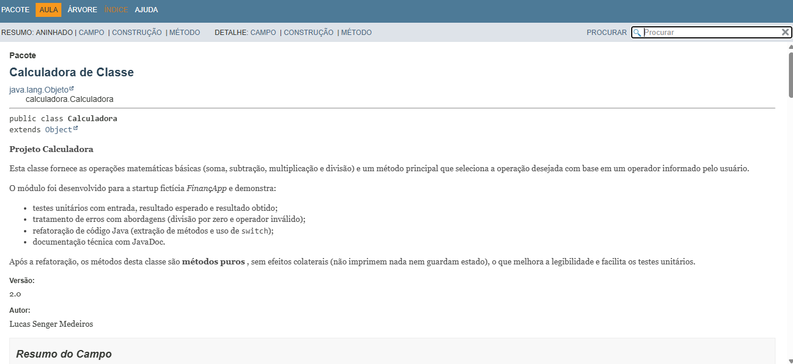
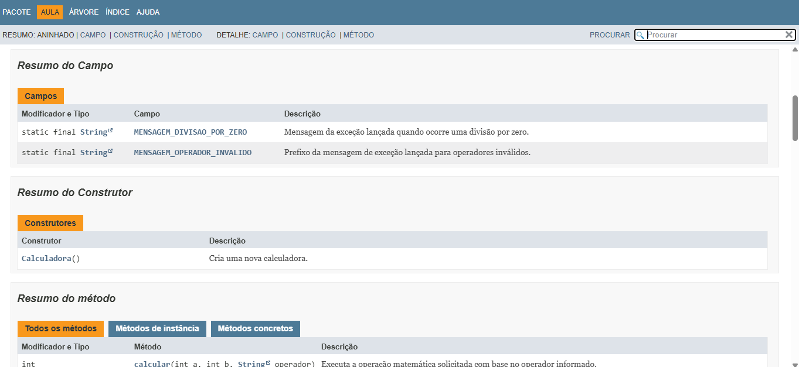
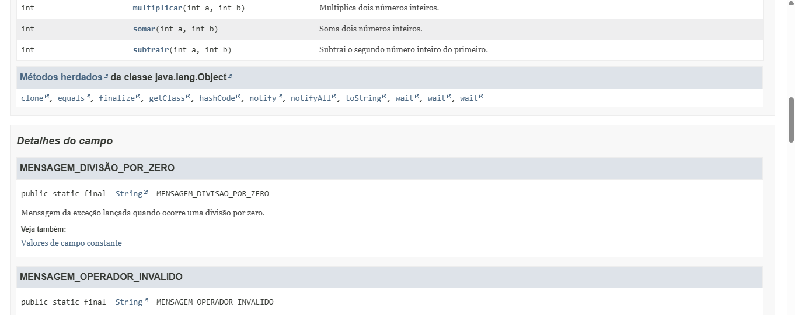
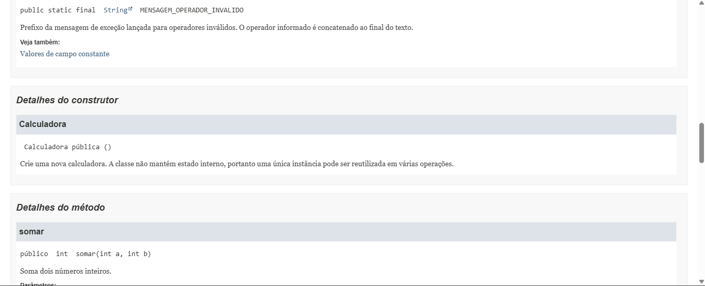
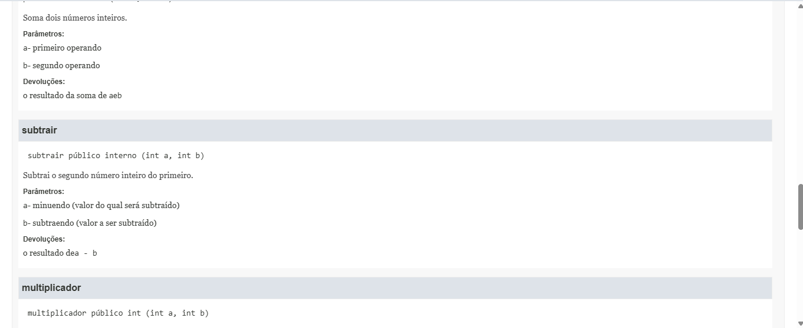
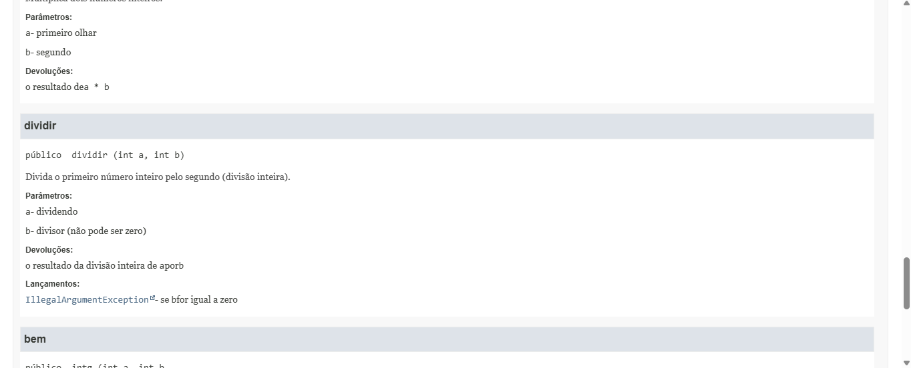
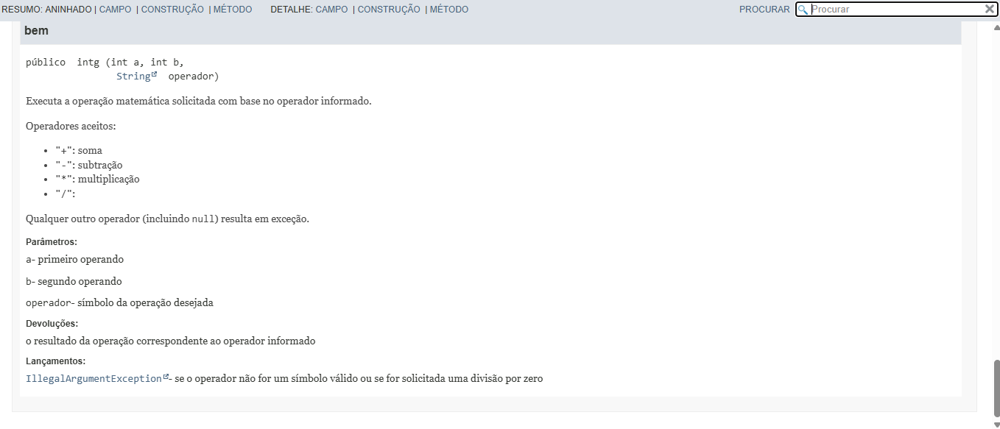

# Projeto Calculadora — FinançApp

> Projeto acadêmico desenvolvido com foco em Qualidade de Software, Testes, Refatoração, Documentação e Versionamento.

---

## 1. Identificação do Projeto

**Projeto:** Projeto Calculadora  
**Contexto:** FinançApp  
**Aluno:** Lucas Senger Medeiros  
**RA:** 250995  
**Curso:** Análise e Desenvolvimento de Sistemas  
**Disciplina:** UI/UX  
**Professor:** ohata  
**Semestre:** 2026.2  

---

## 2. Visão Geral

O projeto consiste no desenvolvimento de um módulo de cálculos matemáticos básicos em Java para a startup fictícia **FinançApp**.

O módulo foi desenvolvido com o objetivo de ser utilizado futuramente em funcionalidades de controle financeiro, como:

- orçamento mensal;
- divisão de despesas;
- projeções financeiras;
- cálculos auxiliares.

Além do funcionamento correto das operações, o projeto aplica práticas de qualidade de software relacionadas a:

- testes;
- tratamento de erros;
- refatoração;
- documentação;
- versionamento;
- manutenção de código.

---

## 3. Problema

Durante o desenvolvimento da aplicação FinançApp, foi identificada a necessidade de criar um módulo matemático reutilizável.

Entretanto, a equipe definiu que o módulo não deveria apenas funcionar corretamente, mas também apresentar:

- código legível;
- testes automatizados;
- tratamento de falhas;
- documentação técnica;
- controle de versões;
- facilidade de manutenção.

O desafio consiste, portanto, em desenvolver uma solução funcional e ao mesmo tempo aplicar boas práticas de Engenharia de Software.

---

## 4. Objetivo

### 4.1 Objetivo Geral

Desenvolver uma calculadora em Java aplicando práticas de qualidade, testes, documentação, refatoração e versionamento.

### 4.2 Objetivos Técnicos

- implementar operações matemáticas básicas;
- tratar entradas inválidas;
- impedir divisão por zero;
- desenvolver testes automatizados;
- refatorar o código sem alterar seu comportamento;
- documentar classes e métodos com JavaDoc;
- gerar documentação HTML;
- utilizar Git e GitHub;
- organizar commits e branches;
- manter documentação técnica no README.

---

## 5. Escopo Funcional

A aplicação deverá oferecer as seguintes operações:

| ID | Funcionalidade | Descrição | Status |
|---|---|---|---|
| RF01 | Soma | Soma dois números inteiros | ✅ |
| RF02 | Subtração | Subtrai dois números inteiros | ✅ |
| RF03 | Multiplicação | Multiplica dois números inteiros | ✅ |
| RF04 | Divisão | Divide dois números inteiros | ✅ |
| RF05 | Validação de divisão | Impede divisão por zero | ✅ |
| RF06 | Operação inválida | Trata operadores não suportados | ✅ |

---

## 6. Requisitos Não Funcionais

| ID | Categoria | Requisito |
|---|---|---|
| RNF01 | Qualidade | O código deve possuir organização e legibilidade |
| RNF02 | Testabilidade | As operações devem possuir testes automatizados |
| RNF03 | Manutenção | O código deve permitir refatoração sem alteração funcional |
| RNF04 | Documentação | Classes e métodos devem possuir JavaDoc |
| RNF05 | Versionamento | O projeto deve utilizar Git e GitHub |
| RNF06 | Confiabilidade | Erros não devem interromper inesperadamente a execução |

---

## 7. Tecnologias Utilizadas

| Tecnologia | Versão | Utilização |
|---|---|---|
| Java | 21.0.10 (Temurin LTS) | Desenvolvimento |
| JDK | 21.0.10 | Compilação e geração do JavaDoc |
| Classe `TesteCalculadora` | — | Testes unitários (entrada, esperado e obtido) |
| Git | 2.54.0 | Controle de versão |
| GitHub | — | Repositório remoto |
| JavaDoc | — | Documentação |
| IDE | Eclipse IDE | Ambiente de desenvolvimento |

---

## 8. Estrutura do Projeto

```text
projeto_calculadora/
│
├── src/
│   └── calculadora/
│       ├── Calculadora.java
│       └── TesteCalculadora.java
│
├── docs/
│   └── index.html
│
├── images/
│   ├── testes/
│   ├── javadoc/
│   └── refatoracao/
│
├── README.md
└── .gitignore
```

---

## 9. Explicação das Operações

A classe `Calculadora` (pacote `calculadora`) disponibiliza um método para cada operação e um método principal, `calcular`, que escolhe a operação pelo operador informado.

| Operador | Método | Exemplo | Resultado | Observação |
|---|---|---|---|---|
| `+` | `somar(a, b)` | `calcular(2, 3, "+")` | `5` | — |
| `-` | `subtrair(a, b)` | `calcular(10, 4, "-")` | `6` | — |
| `*` | `multiplicar(a, b)` | `calcular(3, 5, "*")` | `15` | — |
| `/` | `dividir(a, b)` | `calcular(8, 2, "/")` | `4` | Divisão inteira |
| `/` com `b = 0` | `dividir(a, b)` | `calcular(8, 0, "/")` | exceção | `IllegalArgumentException("Divisão por zero não é permitida.")` |
| outro símbolo ou `null` | `calcular(...)` | `calcular(5, 5, "x")` | exceção | `IllegalArgumentException("Operador inválido: x")` |

### Tratamento de erros

- **Divisão por zero:** bloqueada em `dividir`, com mensagem informativa.
- **Operador inválido ou nulo:** bloqueado em `calcular`, com mensagem informativa.
- Os erros são lançados como `IllegalArgumentException` e tratados com `try/catch` por quem chama o método, evitando que o programa seja interrompido de forma inesperada.

---

## 10. Testes

A classe `TesteCalculadora` executa os testes e mostra, para cada caso, a **entrada utilizada**, o **resultado esperado**, o **resultado obtido** e o **status**.

| Caso | Entrada | Esperado |
|---|---|---|
| Soma | `2 + 3` | `5` |
| Subtração | `10 - 4` | `6` |
| Multiplicação | `3 * 5` | `15` |
| Divisão | `8 / 2` | `4` |
| Divisão por zero | `8 / 0` | exceção com mensagem de divisão por zero |
| Operação inválida | `5 x 5` | exceção com mensagem de operador inválido |
| Operador nulo | `5 null 5` | exceção com mensagem de operador inválido |

### 10.1 Execução na versão original (branch `main`)

```text
=== TESTES DA CALCULADORA (versao original) ===

--- Soma
Entrada  : a=2, b=3, op=+
Esperado : 5
Resultado = 5
Obtido   : 5
Status   : PASSOU

--- Subtracao
Entrada  : a=10, b=4, op=-
Esperado : 6
Resultado = 6
Obtido   : 6
Status   : PASSOU

--- Multiplicacao
Entrada  : a=3, b=5, op=*
Esperado : 15
Resultado = 15
Obtido   : 15
Status   : PASSOU

--- Divisao
Entrada  : a=8, b=2, op=/
Esperado : 4
Resultado = 4
Obtido   : 4
Status   : PASSOU

--- Divisao por zero
Entrada  : a=8, b=0, op=/
Esperado : 0
Erro: divisao por zero, operação irregular
Resultado = 0
Obtido   : 0
Status   : PASSOU

--- Operacao invalida
Entrada  : a=5, b=5, op=x
Esperado : 0
Operacao invalida
Resultado = 0
Obtido   : 0
Status   : PASSOU

--- Operador nulo
Entrada  : a=5, b=5, op=null
Esperado : 0
Operacao invalida
Resultado = 0
Obtido   : 0
Status   : PASSOU

=== RESUMO: 7/7 testes aprovados ===
```


### 10.2 Execução na versão refatorada (branch `Refatoracao`)

```text
=== TESTES DA CALCULADORA (versao refatorada) ===

--- Soma
Entrada  : a=2, b=3, operador=+
Esperado : 5
Obtido   : 5
Status   : PASSOU

--- Subtracao
Entrada  : a=10, b=4, operador=-
Esperado : 6
Obtido   : 6
Status   : PASSOU

--- Multiplicacao
Entrada  : a=3, b=5, operador=*
Esperado : 15
Obtido   : 15
Status   : PASSOU

--- Divisao
Entrada  : a=8, b=2, operador=/
Esperado : 4
Obtido   : 4
Status   : PASSOU

--- Divisao por zero
Entrada  : a=8, b=0, operador=/
Esperado : IllegalArgumentException("Divisão por zero não é permitida.")
Obtido   : IllegalArgumentException("Divisão por zero não é permitida.")
Status   : PASSOU

--- Operacao invalida
Entrada  : a=5, b=5, operador=x
Esperado : IllegalArgumentException("Operador inválido: x")
Obtido   : IllegalArgumentException("Operador inválido: x")
Status   : PASSOU

--- Operador nulo
Entrada  : a=5, b=5, operador=null
Esperado : IllegalArgumentException("Operador inválido: null")
Obtido   : IllegalArgumentException("Operador inválido: null")
Status   : PASSOU

=== RESUMO: 7/7 testes aprovados ===
```


**Taxa de sucesso:** (7 testes passados / 7 executados) × 100 = **100%** nas duas versões.

---

## 11. Refatoração

A refatoração foi feita na branch `Refatoracao`, sem alterar o comportamento externo da calculadora: os mesmos 7 casos de teste continuam passando.

| Técnica | Antes (`main`) | Depois (`Refatoracao`) |
|---|---|---|
| Extração de métodos | Toda a lógica dentro de `calc` | `somar`, `subtrair`, `multiplicar` e `dividir` |
| Simplificação de condicionais | Cadeia de `if / else if / else` | `switch` com expressões (`->`) |
| Melhoria de nomes | `calc`, `r`, `op` | `calcular`, (sem atributo de estado), `operador` |
| Organização lógica | Cálculo, impressão e estado misturados | Métodos puros, sem `System.out` e sem atributo `r` |
| Eliminação de "números mágicos" de texto | Mensagens escritas direto no código | Constantes `MENSAGEM_DIVISAO_POR_ZERO` e `MENSAGEM_OPERADOR_INVALIDO` |
| Tratamento de erros | Imprime mensagem e retorna `0` | Lança `IllegalArgumentException` com mensagem clara |

### Comparação de comportamento

| Cenário | Versão original | Versão refatorada |
|---|---|---|
| Operações válidas | Retorna o resultado | Retorna o resultado (idêntico) |
| Divisão por zero | Imprime erro e retorna `0` | Lança exceção com mensagem informativa |
| Operador inválido ou nulo | Imprime `Operacao invalida` e retorna `0` | Lança exceção com mensagem informativa |

> Na versão refatorada, o erro deixa de ser "escondido" no valor `0` (que poderia ser confundido com um resultado válido) e passa a ser sinalizado por exceção. O teste foi ajustado com `try/catch` para verificar a mensagem e confirmar que o programa não é interrompido.


---

## 12. Documentação (JavaDoc)

Todas as classes, métodos e atributos possuem comentários JavaDoc, com as anotações `@author`, `@version`, `@param`, `@return` e `@throws`, além de comentários técnicos no código-fonte.

A documentação HTML foi gerada na pasta [`docs/`](docs/). Para visualizar, baixe o repositório e abra `docs/index.html` no navegador.

Comando utilizado (a partir da raiz do projeto):

```bash
javadoc -d docs -encoding UTF-8 -docencoding UTF-8 -charset UTF-8 -author -version -private -sourcepath src calculadora
```















---

## 13. Como Executar

Pré-requisito: JDK 14 ou superior (o código usa `switch` com expressões).

```bash
# Clonar o repositório
git clone https://github.com/sengerlucas01/projeto_calculadora.git
cd projeto_calculadora

# Compilar
mkdir out
javac -encoding UTF-8 -d out src/calculadora/*.java

# Executar os testes
java -cp out calculadora.TesteCalculadora
```

Para ver a versão original, use `git checkout main`; para a refatorada, `git checkout Refatoracao`.

---

## 14. Versionamento

| Branch | Conteúdo |
|---|---|
| `main` | Versão original da calculadora, testes e README inicial |
| `Refatoracao` | Código refatorado, testes ajustados, JavaDoc, pasta `docs/` e README completo |

Histórico de commits (um por hora):

```text
2026-10-27 10:23  chore: cria estrutura inicial do projeto e .gitignore
2026-10-27 11:23  feat: implementa classe Calculadora com as quatro operacoes basicas
2026-10-27 12:23  test: adiciona TesteCalculadora com entradas, esperado e obtido
2026-10-27 13:23  docs: adiciona README da versao original
2026-10-27 14:23  refactor: extrai metodos somar, subtrair, multiplicar e dividir e simplifica condicionais com switch
2026-10-27 15:23  test: ajusta TesteCalculadora para a versao refatorada com tratamento de excecoes
2026-10-27 16:23  docs: adiciona comentarios tecnicos e JavaDoc nas classes, metodos e atributos
2026-10-27 17:23  docs: documenta construtores para eliminar avisos do JavaDoc
2026-10-27 18:23  docs: gera documentacao HTML com JavaDoc na pasta docs
2026-10-27 19:23  docs: adiciona README completo com testes, refatoracao e JavaDoc
```

---

## 15. Repositório

🔗 https://github.com/sengerlucas01/projeto_calculadora

---

## 16. Conclusão

O projeto entrega uma calculadora funcional que também atende às exigências de qualidade da FinançApp: operações corretas, tratamento de erros, testes que mostram entrada/esperado/obtido, refatoração sem perda de comportamento, documentação JavaDoc em HTML e versionamento organizado com Git e GitHub.
